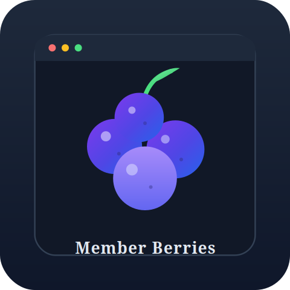
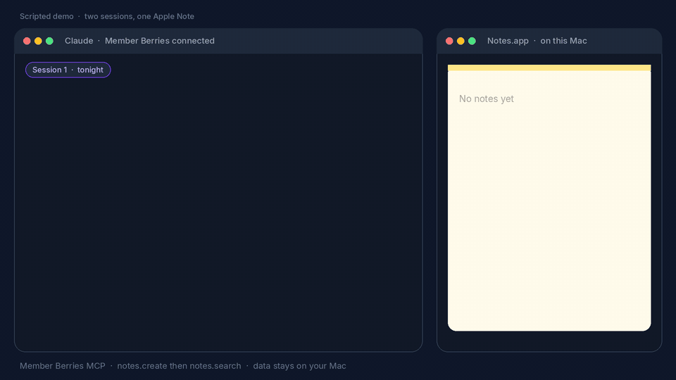

<div align="center">



# Member Berries

**'Member when AI assistants felt like friends?**  
Member Berries 'members.

Your AI assistant (Claude, ChatGPT, Cursor or any MCP client) gets local memory of Calendar, Notes and Reminders — so it actually 'members your day.

[](LICENSE)
[](https://www.typescriptlang.org)
[](https://github.com/M-Pineapple/member-berries-apple-mcp/stargazers)
[](https://glama.ai/mcp/servers/M-Pineapple/member-berries-apple-mcp)

</div>

<p align="center">
  
</p>

<p align="center"><em>Scripted demo, not a live Mac recording. Tonight <code>notes.create</code> writes to Apple Notes. Next morning a new chat <code>notes.search</code> reads it back. Calendar and Reminders use the same local loop. Nothing in this GIF is a real capture. Your data stays on your Mac.</em></p>

A fun macOS MCP that makes your assistant feel like a helpful friend who actually remembers your day. Named in **homage to South Park’s Member Berries** — those nostalgic little berries that go *“'Member …?”* — this server brings that same playful “remember when…” energy to your calendar, notes, and reminders.

Not affiliated with South Park or Comedy Central. Just a wink, a berry cluster, and a local memory file.

**v2.1.3** · [MCP](https://modelcontextprotocol.io) · MIT · Bun · data stays on your Mac

---

> **macOS only.** Member Berries drives Apple Calendar, Reminders and Notes through macOS automation, so its tools only work on a Mac. It installs on Linux or Windows, but the tools there will fail.

## Quick start

Three steps. Then ask *“What's on today?”*

1. **Install Bun and the server**

   ```bash
   brew install bun
   git clone https://github.com/M-Pineapple/member-berries-apple-mcp.git
   cd member-berries-apple-mcp/member-berries
   bun install
   ```

2. **Point your MCP client at it**

   Claude Desktop example (same `bun run …/index.ts` command works in ChatGPT, Cursor, Claude Code or any other MCP host):

   ```json
   {
     "mcpServers": {
       "member-berries": {
         "command": "bun",
         "args": ["run", "/ABSOLUTE/PATH/member-berries-apple-mcp/member-berries/index.ts"]
       }
     }
   }
   ```

   Restart the host after saving.

3. **Talk to it**

   Grant macOS automation / Calendar / Reminders / Notes access when prompted. Keep Reminders open for reminder tools. Then ask *“What's on today?”*

**Optional but tasty:** paste [`member-berries/CLAUDE_PROMPT_SETUP.md`](member-berries/CLAUDE_PROMPT_SETUP.md) into custom instructions for the full Member Berries personality. Built-in starters still work without it.

---

## What is Member Berries?

A personality-first fork of [apple-mcp](https://github.com/dhravya/apple-mcp), stripped to Calendar / Notes / Reminders and wrapped in a local day-memory layer:

- **"How did your dentist appointment go?"** — remembers completed events  
- **"Don't forget about that presentation at 2pm!"** — proactive reminders  
- **"I see you created that project outline"** — tracks your notes  
- **"What's on today?"** — one-shot `briefing` tool  

Same tools, friendlier vibe. The assistant stops sounding like a robot reading a database and starts sounding like someone who 'members your day.

---

## Who is this for?

| You are… | Start here |
|---|---|
| A macOS user who wants an assistant with *personality* | Install above, paste the optional prompt, ask *“What's on today?”* |
| On Cursor, ChatGPT, Claude Code or another MCP host | Same Bun server — see host config |
| Privacy-first | Local `~/.member-berries-memory.json` (mode 600). No cloud sync from this server |
| Already using Memory Service / other Apple MCPs | This is **fun day-memory + Apple surfaces**, not general conversation memory |

---

## Features

- **Briefing** — one `briefing` / `today` call for calendar, due reminders, note titles, starters
- **Calendar memory** — search, list, open, create
- **Notes** — title + snippet by default; full body on demand
- **Reminders** — list, search, create, complete, delete, listById
- **Member Berries memory** — built-in conversation starters ('member energy included)
- **Focused scope** — Calendar, Notes, Reminders only (no Messages / Mail / Contacts)

---

## Usage

Once the host has the server running, talk to it in natural language:

- "What's on today?"
- "How did the dentist appointment go?"
- "Don't forget about that presentation at 2pm"
- "Search my notes for the project outline"
- "Create a reminder to buy milk"

The `briefing` tool is the one-shot day summary. Calendar, Notes and Reminders cover the rest. See [MCP tools](#mcp-tools) and [`member-berries/README.md`](member-berries/README.md) for operation names.

---

## MCP tools

| Tool | Operations |
|---|---|
| `briefing` | `today` — day summary with a side of 'member |
| `calendar` | `search`, `list`, `open`, `create` |
| `notes` | `search`, `list`, `get`, `create` (`includeBody`, `folderName`) |
| `reminders` | `list`, `search`, `open`, `create`, `listById`, `complete`, `delete` |
| `memberberries` | `get_starters`, `get_memories`, `check_events` |

More detail: [`member-berries/README.md`](member-berries/README.md).

---

## More MCP servers by M-Pineapple

Other MCP servers in this portfolio:

- [Claude Project Coordinator](https://github.com/M-Pineapple/Claude-Project-Coordinator). Track Xcode projects, status, tech stack and health.
- [CryptoAnalysisMCP](https://github.com/M-Pineapple/CryptoAnalysisMCP). Cryptocurrency technical analysis for Claude Desktop.
- [Warp Command Runner](https://github.com/M-Pineapple/warp-command-runner). Give any chat AI a real terminal.
- [Msty Admin MCP](https://github.com/M-Pineapple/msty-admin-mcp). Administer Msty Studio Desktop.
- [SeaShell](https://github.com/M-Pineapple/seashell). Talk to Claude from any terminal block.
- [TextEdit MCP](https://github.com/M-Pineapple/TextEdit-MCP). Formatted RTF documents via macOS TextEdit.
- [HubSpot Auditor](https://github.com/M-Pineapple/hubspot-auditor). Read-only HubSpot portal audit.

---

## Support this project

If Member Berries has made your assistant feel more like a helpful friend who remembers your day, consider buying me a coffee:

<a href="https://www.buymeacoffee.com/mpineapple" target="_blank"></a>

Your support helps keep the berries fresh: Apple integrations, personality polish, and compatibility with host updates.

Thank you for helping it 'member!

If this saves you time, a [star](https://github.com/M-Pineapple/member-berries-apple-mcp/stargazers) helps others find it.

---

## License

MIT. See [LICENSE](./LICENSE). Fork lineage: [apple-mcp](https://github.com/dhravya/apple-mcp).

Member Berries is an independent project. The name pays homage to South Park’s Member Berries; no affiliation or endorsement is implied.

---

*'Member when AI assistants felt like friends? Member Berries 'members.*
